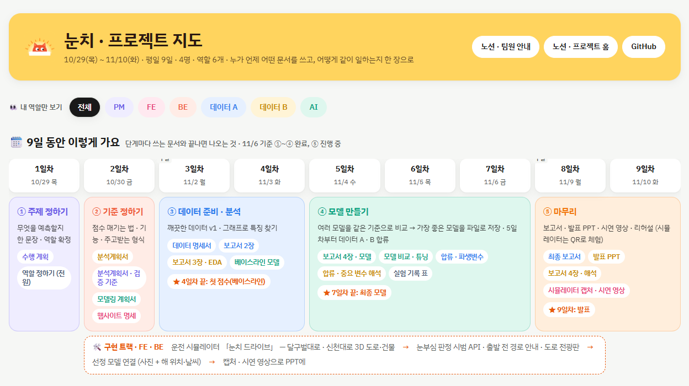
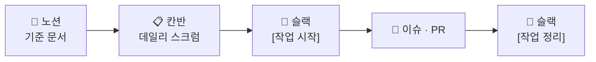

 

  

       

   

---

## 👀 Nunchi(눈치)는

**눈치**는 말하지 않아도 상황을 먼저 알아채는 감각입니다.
해가 정면에 낮게 들어오거나 밝은 도로에서 터널로 들어갈 때, 같은 길도 앞이 잘 안 보이는 순간이 생깁니다.
저희는 이런 **빛의 변화를 데이터로 먼저 알아채고**, 눈부심이 적은 길을 고르거나 피하기 어려운 구간에 미리 대비할 수 있게 안내합니다.
그 결과를 운전석에 앉은 듯 체험하는 **운전 시뮬레이터**까지 만들었습니다.

## 🎯 프로젝트

| | |
|---|---|
| 📌 **주제** | ☀️ 빛 변화에 대비하는 주행 안내 — 정면 태양광 눈부심 · 터널 입출구 밝기 전환 |
| 🛣️ **시범 구간** | 대구 달구벌대로(동서) · 신천대로(남북) |
| 🔮 **만든 것** | 예측 모델 2개 + 두 결과를 잇는 통합 안내 + 운전 시뮬레이터 「눈치 드라이브」 |
| 🎤 **발표** | 2026.11 최종 발표 완료 · 보고서 · 발표 PPT · 시연 영상 · 시뮬레이터 체험(QR) |
| 📏 **원칙** | 같은 데이터 · 같은 정답 · 같은 분할에서 비교하고, 규칙에도 같은 기회를 줍니다 |

## 🧠 모델

| 모델 | 하는 일 | 상태 |
|---|---|---|
| ☀️ **태양광 눈부심 분류** | 전방 사진 + 해 위치 · 날씨로 눈부심을 정상 · 눈부심 · 심함 3등급 판정 | ✅ 두 단계 로지스틱 회귀 · 평균 F1 0.640 · API 배포 |
| 🚇 **터널 암순응 분류** | 터널 · 지하차도 입구 사진으로 바깥 밝기와 입구 위험도(하 · 중 · 상) 추정 | ✅ Ridge + 두 단계 로지스틱 · 처음 보는 카메라 입구 66장 F1 0.844 |
| 🧭 **통합 주행 안내** | 두 모델의 결과를 위치 · 시각 · 진행 방향에 맞춰 지도 · 경고로 연결 | ✅ 같은 사진 검수 로직 · 시뮬레이터 체험 (실제 도로 연동은 후속) |

## 🏁 결과

| | |
|---|---|
| ☀️ **눈부심** | 71개 실험 · 모델 5번 개선 → 두 단계 로지스틱 회귀. 다른 출처 공공 사진(AI Hub)에서 정상 사진을 가려낸 비율(특이도) 가장 좋은 규칙 23% → 모델 72% |
| 🚇 **터널** | 밝기를 먼저 맞히던 LightGBM(F1 0.526) → 등급을 바로 가르는 두 단계 로지스틱(F1 0.844) · 12월 사진 22장 모두 맞힘 |
| 🚗 **시뮬레이터** | 대구 달구벌대로 · 신천대로 3D 재현 · 출발 전 경로 판정 · 주행 중 사전 경고 · 휴대폰 카메라 즉시 판정 |
| ⚠️ **남은 과제** | 다른 계절 · 카메라 검증 · 두 모델의 실제 입구 사진 공동 성능 · 실제 운전에서의 효과 |

## 🗺️ 프로젝트 지도

9일 일정 · 문서 6장 · 역할 · 같이 일한 방식을 한 장으로 모았어요. 그림을 누르면 「내 역할만 보기」가 되는 지도가 열려요.

## 🗂️ 저장소

| | 저장소 | 하는 일 |
|:---:|---|---|
| 🧪 | [**Nunchi-ML_AI**](https://github.com/Nunchi-ML/Nunchi-ML_AI) | 데이터 정제 · 실험 · 세 모델 학습과 추론 묶음 |
| ⚙️ | [**Nunchi-ML_BE**](https://github.com/Nunchi-ML/Nunchi-ML_BE) | 눈부심 판정 API (FastAPI · Render) · [Swagger](https://nunchi-glare-api.onrender.com/docs) |
| 🎨 | [**Nunchi-ML_FE**](https://github.com/Nunchi-ML/Nunchi-ML_FE) | 운전 시뮬레이터 「눈치 드라이브」 (React · three.js · Vercel) · [체험하기](https://nunchi-drive.vercel.app) |

## 👥 팀 「눈치」

<table>
  <tr>
    <td align="center" width="150"><a href="https://github.com/FAITRUEE"> <b>이성진</b> 팀장 · 태양광 눈부심 분류 시뮬레이터(FE · BE)</a></td>
    <td align="center" width="150"><a href="https://github.com/jaehyuck5"> <b>최재혁</b> 터널 암순응 분류 모델</a></td>
    <td align="center" width="150"><a href="https://github.com/kwonsuyoung0-rgb"> <b>권수영</b> 기획 · 문서 · 보고서</a></td>
    <td align="center" width="150"><a href="https://github.com/pbsu0413-byte"> <b>박범수</b> 통합 주행 안내 모델</a></td>
  </tr>
</table>

> 처음에는 PM · FE · BE / 데이터 A · B / AI로 나눠 시작했고, 5일차부터 모두 모델 실험에 합류해 모델별로 맡았어요.

## 🔁 일하는 방식

처음이라면: [👋 팀원 안내](https://app.notion.com/p/df8fb1d2f0db45dbab41cdd49edb5358) · [🐙 GitHub 컨벤션](https://app.notion.com/p/c86986ef9f3a4a3caedabfc16b6ff0b7)

## 📅 일정

| 단계 | 기간 | 끝나는 기준 | 상태 |
|---|---|---|:---:|
| 1️⃣ 주제 · 문제 정의 | 10/29 | 타깃과 사용 장면이 한 문장으로 | ✅ |
| 2️⃣ 기준 고정 | 10/30 | 평가 지표 · 분할 방식 · 기능 · API 입출력 확정 | ✅ |
| 3️⃣ 데이터 준비 · 분석 | 11/2 ~ 11/3 | 데이터 명세서 + 베이스라인 점수 | ✅ |
| 4️⃣ 모델링 | 11/4 ~ 11/6 | 모델별 대표 모델 · 추론 묶음 | ✅ |
| 5️⃣ 검토 · 마무리 | 11/9 ~ 11/10 | 보고서 · 발표 PPT · 시연 영상 (11/9 18:00 제출 · 11/10 발표) | 🔄 |
