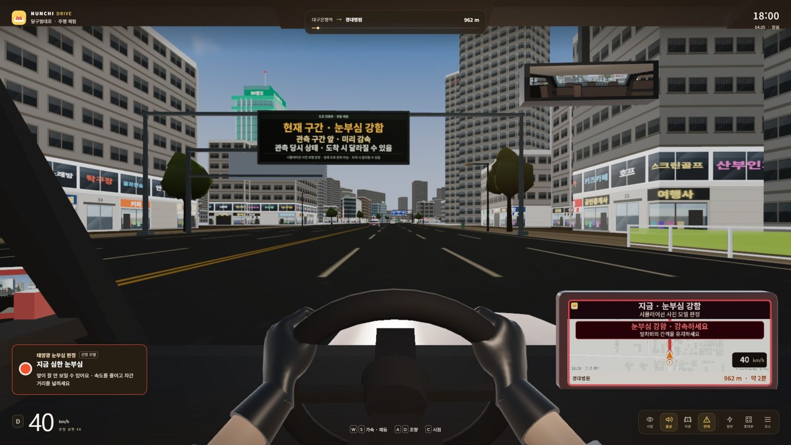
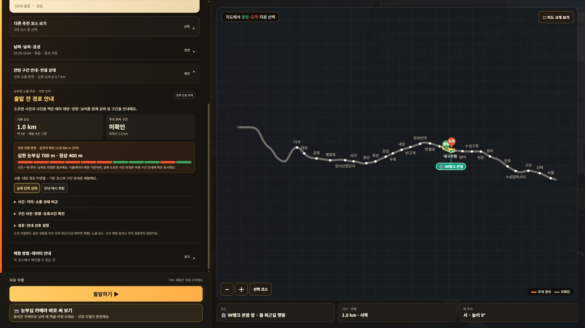
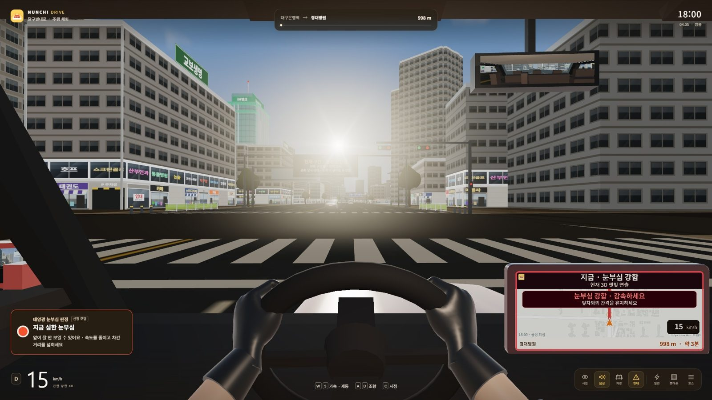
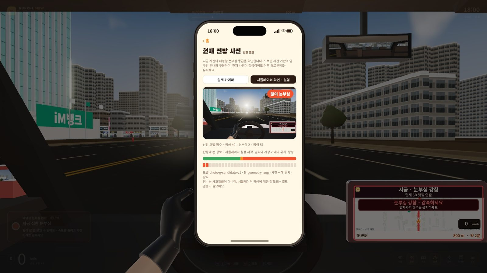
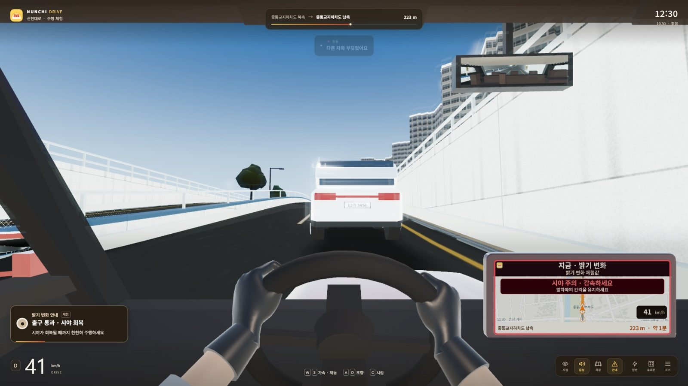
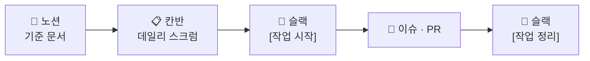

 

  

       

    

---

## 👀 눈치는

해가 정면에 낮게 들어오거나 밝은 도로에서 터널로 들어갈 때, 같은 길도 순간 앞이 잘 안 보입니다. 
**눈치**는 이런 빛의 변화를 데이터로 먼저 알아채고, 그 구간에 들어가기 전에 미리 알려 주는 주행 안내입니다.

운전 시뮬레이터 「눈치 드라이브」 · 대구 달구벌대로 · 신천대로 · <a href="https://nunchi-drive.vercel.app">직접 체험하기 →</a>

## 🧠 두 예측 모델

<table>
  <tr>
    <th width="50%">☀️ 태양광 눈부심 분류</th>
    <th width="50%">🚇 터널 암순응 분류</th>
  </tr>
  <tr>
    <td>사진 + 해 위치 · 날씨로 정상 · 눈부심 · 심함을 판정</td>
    <td>터널 입구 사진으로 안팎의 밝기 차이(하 · 중 · 상)를 판정</td>
  </tr>
  <tr>
    <td>두 단계 로지스틱 회귀 <b>평균 F1 0.640</b></td>
    <td>Ridge + 두 단계 로지스틱 회귀 <b>처음 보는 카메라 F1 0.844</b></td>
  </tr>
</table>

두 결과는 같은 사진인지 확인하는 통합 로직으로 묶어, 시뮬레이터에서 출발 전 · 주행 중 안내로 보여 줍니다.

## 🚗 눈치 드라이브

<table>
  <tr>
    <td width="50%"> 출발 전 · 코스 미리 판정</td>
    <td width="50%"> 도로 전광판 · 앞 구간 안내</td>
  </tr>
  <tr>
    <td> 카메라 앱 · 바로 판정</td>
    <td> 지하차도 · 밝기 변화 체험</td>
  </tr>
</table>

## 🗂️ 저장소

| 저장소 | 내용 |
|---|---|
| 🧪 [Nunchi-ML_AI](https://github.com/Nunchi-ML/Nunchi-ML_AI) | 데이터 정제 · 실험 · 모델 학습과 추론 |
| ⚙️ [Nunchi-ML_BE](https://github.com/Nunchi-ML/Nunchi-ML_BE) | 눈부심 판정 API (FastAPI · Render) |
| 🎨 [Nunchi-ML_FE](https://github.com/Nunchi-ML/Nunchi-ML_FE) | 시뮬레이터 「눈치 드라이브」 (React · three.js) |

## 👥 팀 「눈치」

<table>
  <tr>
    <td align="center" width="150"><a href="https://github.com/FAITRUEE"> <b>이성진</b> 팀장 · 눈부심 모델 · 시뮬레이터</a></td>
    <td align="center" width="150"><a href="https://github.com/jaehyuck5"> <b>최재혁</b> 터널 암순응 모델</a></td>
    <td align="center" width="150"><a href="https://github.com/kwonsuyoung0-rgb"> <b>권수영</b> 기획 · 문서 · 보고서</a></td>
    <td align="center" width="150"><a href="https://github.com/pbsu0413-byte"> <b>박범수</b> 통합 주행 안내</a></td>
  </tr>
</table>

<b>📋 프로젝트 기록</b> — 일정 · 일하는 방식 · 프로젝트 지도

 

| 단계 | 기간 | 끝나는 기준 | 상태 |
|---|---|---|:---:|
| 1️⃣ 주제 · 문제 정의 | 10/29 | 타깃과 사용 장면이 한 문장으로 | ✅ |
| 2️⃣ 기준 고정 | 10/30 | 평가 지표 · 분할 방식 · 기능 · API 입출력 확정 | ✅ |
| 3️⃣ 데이터 준비 · 분석 | 11/2 ~ 11/3 | 데이터 명세서 + 베이스라인 점수 | ✅ |
| 4️⃣ 모델링 | 11/4 ~ 11/6 | 모델별 대표 모델 · 추론 묶음 | ✅ |
| 5️⃣ 검토 · 마무리 | 11/9 ~ 11/10 | 보고서 · 발표 PPT · 시연 영상 (11/9 18:00 제출 · 11/10 발표) | ✅ |

[🗺️ 프로젝트 지도](https://nunchi-ml.github.io/) · [👋 팀원 안내](https://app.notion.com/p/df8fb1d2f0db45dbab41cdd49edb5358) · [🐙 GitHub 컨벤션](https://app.notion.com/p/c86986ef9f3a4a3caedabfc16b6ff0b7) · [📦 최종 결과물 Release](https://github.com/Nunchi-ML/.github/releases/tag/v1.0-final)

