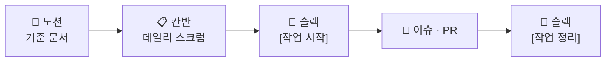

 

  

       

 

---

## 👀 Nunchi(눈치)는

**눈치**는 말하지 않아도 상황을 먼저 알아채는 감각입니다.
저희는 데이터에서 **다음에 일어날 일의 신호를 먼저 읽어 내는 모델**을 만들고, 그 모델을 직접 써 볼 수 있는 화면까지 만듭니다.

## 🎯 프로젝트

| | |
|---|---|
| 📌 **주제** | 1일차(10/29)에 확정합니다 |
| 🔮 **만드는 것** | 예측 모델 + 머신러닝 결과를 보여주는 웹사이트 (데이터 살펴보기 · 모델 비교 · 예측해 보기) |
| 🎤 **발표** | 시연 없이 PPT에 모두 담아요 (웹사이트는 화면 캡처로) |
| 📏 **원칙** | 모든 실험은 같은 검증 기준 · 같은 데이터셋 버전으로 잽니다 |

## 🗂️ 저장소

| | 저장소 | 하는 일 | 담당 |
|:---:|---|---|---|
| 🧪 | [**Nunchi-ML_AI**](https://github.com/Nunchi-ML/Nunchi-ML_AI) | 데이터 정제 · EDA · 모델 실험 · 최종 파이프라인 | 데이터 A · B, AI |
| ⚙️ | [**Nunchi-ML_BE**](https://github.com/Nunchi-ML/Nunchi-ML_BE) | 모델 결과 · 예측 API | BE |
| 🎨 | [**Nunchi-ML_FE**](https://github.com/Nunchi-ML/Nunchi-ML_FE) | 머신러닝 결과 웹사이트 | FE |

## 👥 팀 「눈치」

<table>
  <tr>
    <td align="center" width="150"><a href="https://github.com/FAITRUEE"> <b>이성진</b> 팀장 · PM · FE · BE</a></td>
    <td align="center" width="150"><a href="https://github.com/jaehyuck5"> <b>jaehyuck5</b> 역할 1일차 확정</a></td>
    <td align="center" width="150"><a href="https://github.com/kwonsuyoung0-rgb"> <b>권수영</b> 역할 1일차 확정</a></td>
    <td align="center" width="150"><a href="https://github.com/pbsu0413-byte"> <b>박범수</b> 역할 1일차 확정</a></td>
  </tr>
</table>

> 데이터셋 v1이 나오면 데이터 엔지니어도 모델 실험에 합류해요. 역할은 시작점이고, 단계마다 모이는 곳이 바뀝니다.

## 🔁 일하는 방식

처음이라면: [👋 팀원 안내](https://app.notion.com/p/df8fb1d2f0db45dbab41cdd49edb5358) · [🐙 GitHub 컨벤션](https://app.notion.com/p/c86986ef9f3a4a3caedabfc16b6ff0b7)

## 📅 일정 (가안)

| 단계 | 기간 | 끝나는 기준 |
|---|---|---|
| 1️⃣ 주제 · 문제 정의 | 10/29 | 타깃과 사용 장면이 한 문장으로 |
| 2️⃣ 기준 고정 | 10/30 | 평가 지표 · 분할 방식 · 기능 · API 입출력 확정 |
| 3️⃣ 데이터 준비 · 분석 | 11/2 ~ 11/3 | 데이터셋 v1 + 베이스라인 점수 |
| 4️⃣ 모델링 | 11/4 ~ 11/6 | 최종 모델 · 파이프라인 파일 |
| 5️⃣ 검토 · 마무리 | 11/9 ~ 11/10 | 보고서 · 발표 PPT 완성 (웹사이트 화면 포함) |
